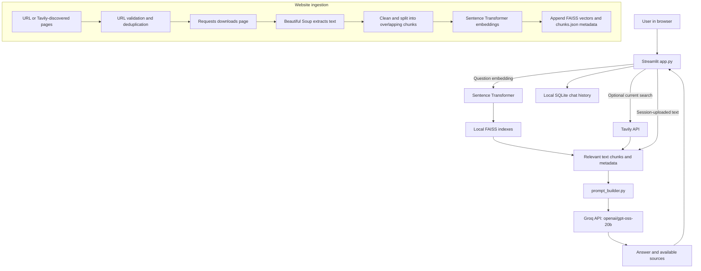

# Web RAG Assistant

A Python and Streamlit research chatbot that answers questions using an optional
local website knowledge base, live Tavily search results, and documents uploaded
for the current app session. It uses Groq for response generation.

> **Model/API:** This project uses Groq's Chat Completions API with
> `openai/gpt-oss-20b`. It does **not** use Google Gemini.

## Problem statement

A general-purpose language model may not have the contents of a specific web
page or document available when answering a question. This application retrieves
relevant text from indexed websites, optional web search, and session uploads,
then supplies that text as context to a language model. Source links are shown
when available; their presence does not independently verify every answer.

## Features

- Streamlit chat interface with locally saved conversations.
- Optional Tavily search for current web excerpts during question answering.
- Local semantic search over website content using Sentence Transformers and FAISS.
- Add websites directly or discover candidate pages using Tavily.
- Incrementally append newly indexed website chunks.
- Upload supported PDF, DOCX, text, image, and video files. Uploads are available
  for the current Streamlit session only.
- Local SQLite conversation history, source display, and chat rename, clear, and
  deletion controls.
- Session-persisted dark and light appearance settings with monochrome styling.
- Groq connection test and user-facing API/network errors.

## Technology stack

| Component | Role |
|---|---|
| Python 3.10+ | Application and backend modules |
| Streamlit | Browser UI and session state |
| Groq API, `openai/gpt-oss-20b` | Hosted answer generation |
| Tavily API | Optional web search |
| Sentence Transformers, `all-MiniLM-L6-v2` | Local text embeddings |
| FAISS `IndexFlatL2` | Local vector similarity search |
| NumPy | Embedding-array handling |
| Requests and Beautiful Soup | HTTP requests and HTML extraction |
| SQLite | Local chat-history storage |
| python-dotenv | Local `.env` configuration |
| pypdf, python-docx | PDF and Word text extraction |
| Pillow, pytesseract | Image handling and OCR integration |

Image OCR also requires the separate Tesseract executable. Installing the Python
`pytesseract` package alone does not install that executable.

## Architecture



### Website ingestion workflow

1. Provide a URL directly or use Tavily to discover candidate pages.
2. Validate and normalize the URLs; skip duplicates already indexed.
3. Fetch pages using Requests and extract readable content and titles using
   Beautiful Soup.
4. Clean whitespace and split page text into 500-word chunks with 50-word
   overlap.
5. Embed the new chunks locally and append them to the FAISS index and matching
   `chunks.json` records.

### Question-answering workflow

1. Streamlit receives the question and recent conversation.
2. If enabled, Tavily returns current search excerpts.
3. The app embeds the question once and searches the saved website index and any
   session upload index.
4. Retrieved excerpts and source metadata are formatted into a bounded prompt.
5. The prompt and recent conversation turns are sent to Groq.
6. The answer and available source links are displayed and the chat is stored in
   SQLite.

Chat-time Tavily results are used for that answer but are not automatically
persisted into the website index.

## Project structure

```text
.
├── .streamlit/
│   └── config.toml
├── app.py
├── api_keys.py
├── chat_history.py
├── embeddings.py
├── groq_client.py
├── groq_test.py
├── processor.py
├── prompt_builder.py
├── rag_pipeline.py
├── scraper.py
├── search.py
├── test_prompt_builder.py
├── test_rag_groq.py
├── test_saved_database.py
├── test_vector_store.py
├── uploaded_documents.py
├── vector_store.py
├── requirements.txt
├── .env.example
├── tests/
│   ├── test_chat_history.py
│   ├── test_core.py
│   └── test_uploaded_documents.py
```

The local website data files (`faiss_index.bin` and `chunks.json`), local chat
database, `.env`, and virtual environment are intentionally not part of this
source tree for GitHub. The application starts with an empty website index if
both index files are absent; use **Manage knowledge base** to add pages.

## Local installation

Use Python 3.10 or newer. From PowerShell in the project directory:

```powershell
py -3.11 -m venv .venv
.\.venv\Scripts\Activate.ps1
python -m pip install --upgrade pip
python -m pip install -r requirements.txt
```

On macOS or Linux, create and activate the virtual environment with the
platform's corresponding `python3 -m venv .venv` and activation command.

The first embedding-model use may download model files and needs internet access.
The deployment environment also needs enough memory and disk to install the
Sentence Transformers/PyTorch dependencies and load the embedding model.

### Environment variables and secrets

For local development, copy `.env.example` to `.env` and replace the placeholders
with your own keys:

```dotenv
GROQ_API_KEY=your_groq_api_key
TAVILY_API_KEY=your_tavily_api_key
```

`GROQ_API_KEY` is required to generate answers. `TAVILY_API_KEY` enables web
search and topic-based discovery; direct website URLs can be indexed without
Tavily. The app reads environment/`.env` values first and then checks
`st.secrets`, which is used by Streamlit Community Cloud. Never commit `.env` or
paste real keys into code, README files, screenshots, or logs.

## Run locally

With the virtual environment active and the project directory as the current
directory:

```powershell
streamlit run app.py
```

Open the local URL printed by Streamlit, usually `http://localhost:8501`.

## Run tests

The offline unit suite uses mocks for network-dependent behavior and does not
make real Groq or Tavily requests:

```powershell
python -m unittest discover -s tests -v
```

The conversation-history tests also cover renaming, duplicate titles, empty-title
validation, and message preservation.

An optional live Groq connectivity check is separate and does make a real API
request:

```powershell
python groq_test.py
```

## Deploy on Streamlit Community Cloud

1. Create a GitHub repository and upload the project source. Do not upload `.env`,
   `.venv`, `chat_history.sqlite3`, `faiss_index.bin`, or `chunks.json`.
2. Sign in to Streamlit Community Cloud and choose **Create app**.
3. Select the repository, branch, and `app.py` as the main file.
4. Choose Python 3.11 in the app's advanced settings.
5. In the app settings' **Secrets** section, add:

   ```toml
   GROQ_API_KEY = "your_groq_api_key"
   TAVILY_API_KEY = "your_tavily_api_key"
   ```

   Keep the actual values private. Tavily is optional; without it, automatic web
   search and topic-based web discovery will be unavailable, while direct URL
   indexing and local retrieval can still be used.
6. Deploy the app and check its logs for dependency or startup errors. The first
   model load may need to download the embedding model.
7. Add website sources in the app's **Manage knowledge base** controls.

Community Cloud must be able to install the packages in `requirements.txt` and
download the embedding model. This project does not configure a separate Linux
Tesseract system package. Image OCR therefore may be unavailable in the hosted
environment; the app reports an OCR error for images while other supported
document types remain usable.

## Data persistence and deployment limitations

- FAISS website data and SQLite chat history are files on the app's local
  filesystem. Streamlit Community Cloud storage should be treated as ephemeral:
  app restarts, rebuilds, or redeployments may discard data written at runtime.
- The hosted app starts with an empty index because local index files are
  excluded. You can add websites after launch, but those changes are not durable
  unless you arrange separate persistent storage.
- Chat history is local to the running app filesystem and should not be treated
  as durable or shared storage.
- Uploaded documents and their vectors are session-only.
- Tavily and Groq require internet access and valid keys; their quotas and model
  availability depend on current provider policies.
- Website scraping cannot render JavaScript-only pages, and sites may block
  automated requests.
- FAISS uses L2 distance without a relevance threshold or reranking. A nearest
  result is not necessarily relevant.
- Source links identify retrieved material; they do not prove every generated
  statement is supported or correct.
- Image OCR needs the external Tesseract executable. Scanned PDFs are not
  automatically OCRed.

The existing local `faiss_index.bin` and `chunks.json` contain indexed web
content. They are not required for startup and are ignored by Git to avoid
publishing a possibly unreviewed content corpus. Only include a curated initial
corpus if you have reviewed its contents and have the right to publish it.

For durable multi-user storage, a persistent database or object store could be
added later. This project does not currently configure one.

## Security notes

- API keys are read from local `.env` or Streamlit secrets, never hard-coded.
- `.gitignore` excludes secrets and local databases/index data.
- Website URLs and each redirect are validated; non-public DNS addresses are
  rejected before fetching.
- Upload file size is limited to 20 MB, and OCR images are limited to 20
  megapixels.
- Source excerpts are treated by the prompt as reference data, not instructions.
- Do not send sensitive questions or document content to external services
  unless permitted by your privacy requirements. Chat questions may be sent to
  Tavily when web search is on; prompts and relevant excerpts are sent to Groq
  for answer generation.
- DNS addresses are checked before each request, but Requests does not pin the
  resolved address to the later connection. DNS rebinding is therefore not a
  hard network-isolation boundary; only accept URLs from trusted users.

## Future improvements

- Add a retrieval relevance threshold and optional reranking.
- Evaluate retrieval and citation quality on a curated question set.
- Detect changed pages and refresh existing indexed URLs.
- Add persistent storage for hosted index data and chat history.
- Add OCR system-package support to a custom deployment image if image OCR is
  required in the cloud.
